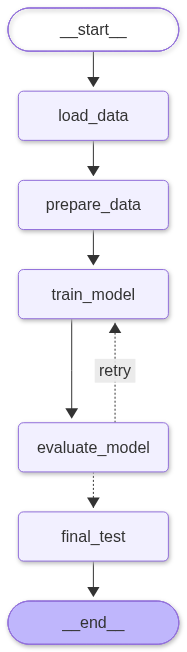
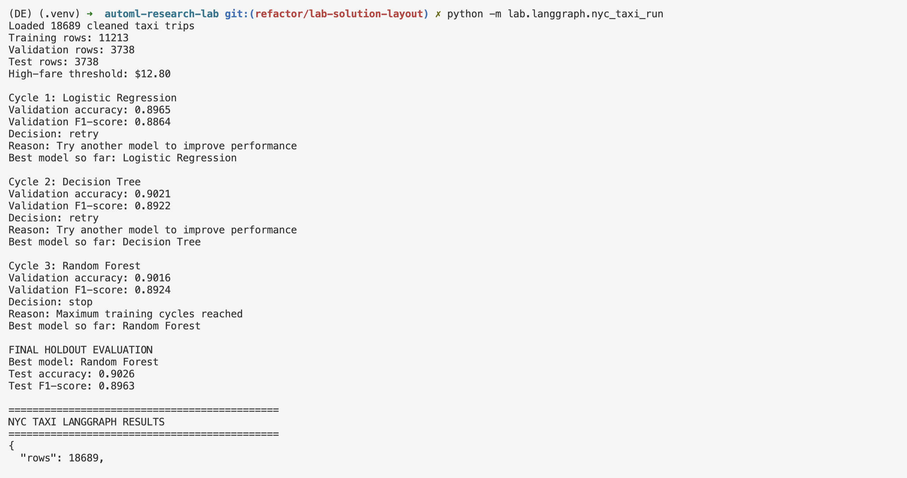
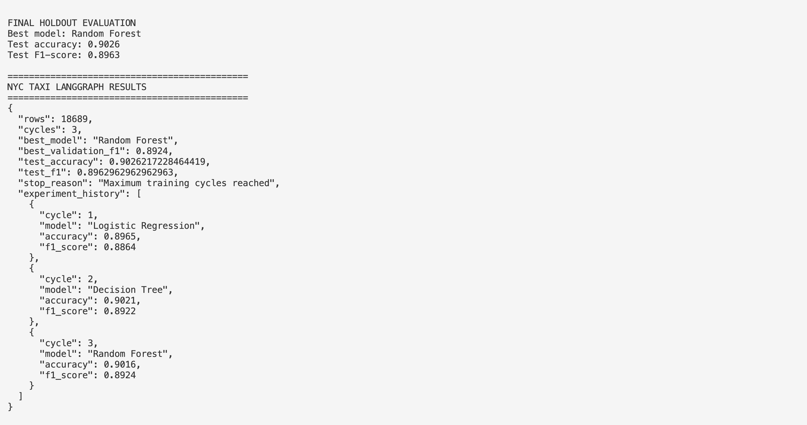

# NYC Taxi Data Pipeline and ML Workflow

## Project Overview

This project uses Apache Airflow and LangGraph to build an automated data processing and machine learning workflow using New York City yellow taxi trip data.

The objective is to predict whether a taxi fare is above the median fare using trip characteristics such as distance, passenger count, pickup time, and pickup borough.

The project consists of two parts:

1. An Airflow DAG that cleans, merges, and stores taxi data in PostgreSQL.
2. A custom LangGraph workflow that trains and evaluates classification models using conditional looping logic.

## Part 1: Apache Airflow Pipeline

### Datasets

Two datasets from the NYC Taxi & Limousine Commission (TLC) are used:

- January 2025 Yellow Taxi Trip Records
- NYC Taxi Zone Lookup Table

The original trip dataset contains approximately 3.48 million records. A reproducible sample of 20,000 trips was selected using `random_state=42`.

### DAG Structure

The custom DAG is located at:

`lab/airflow/dags/nyc_taxi_pipeline.py`

It contains five tasks:

1. **clean_taxi_trips:** Removes trips with nonpositive distances or fares, handles missing passenger counts, and creates pickup hour and weekday features.
2. **clean_taxi_zones:** Validates location IDs and cleans borough and zone information.
3. **merge_taxi_data:** Joins taxi trips with zone information using pickup location IDs.
4. **load_to_postgres:** Loads the merged dataset into the PostgreSQL `taxi_trips_cleaned` table.
5. **read_from_postgres:** Reads the cleaned records from PostgreSQL and saves a machine-learning-ready Parquet file.

The two cleaning tasks run independently before the merge, demonstrating parallel task execution.

### Scheduling

The DAG uses the following Airflow settings:

- Schedule: `@daily`
- Start date: November 1, 2026
- Catchup: `False`
- Maximum active runs: 1

Each scheduled execution reprocesses the same January 2025 sample. It does not automatically download new daily taxi records.

### Data Pipeline Results

- Initial sample: 20,000 trips
- Cleaned dataset: 18,689 trips
- Records removed: 1,311
- Average fare after cleaning: $17.92

The cleaned data is stored in PostgreSQL and exported to:

`artifacts/nyc_taxi/taxi_ml_ready.parquet`

### Successful Airflow DAG Execution

The screenshot below shows the completed Airflow pipeline, including the two parallel cleaning tasks, merge, PostgreSQL load, and database read-back.


## Part 2: Custom LangGraph ML Workflow

### Objective

Predict whether a taxi trip has a fare above the training-set median of $12.80.

The prediction target is `high_fare`, where:

- `1`: Fare greater than $12.80
- `0`: Fare less than or equal to $12.80

The median threshold is calculated using training data only to avoid test-data leakage.

### Input Features

The classification models use:

- Trip distance
- Passenger count
- Pickup hour
- Pickup day of week
- Pickup borough

The actual fare amount is excluded from model inputs because it defines the target.

### Graph Structure

The custom graph is implemented in:

`lab/langgraph/nyc_taxi_graph.py`

It contains five nodes:

1. **load_data:** Loads and validates the Airflow output.
2. **prepare_data:** Creates training, validation, and test splits.
3. **train_model:** Trains a candidate classification model.
4. **evaluate_model:** Evaluates validation performance and decides whether to retry.
5. **final_test:** Retrains the best candidate on development data and evaluates it on the held-out test set.

### Conditional Loop

After each training cycle, the workflow checks the validation F1-score.

- If the score reaches the target, the workflow stops experimenting.
- Otherwise, it tries another model, provided the maximum number of cycles has not been reached.
- After stopping, it selects the candidate with the highest validation F1-score.

The workflow compares Logistic Regression, Decision Tree, and Random Forest.

This is a deterministic, rule-based LangGraph workflow rather than an LLM-powered agent.

### LangGraph Structure Visualization

The graph below shows the five-node workflow, including the conditional retry path from evaluation back to training.



### Data Splitting

- Training: 60% (11,213 records)
- Validation: 20% (3,738 records)
- Test: 20% (3,738 records)

The final test dataset is reserved for evaluation after model selection.

### Model Results

To demonstrate all three training cycles, the validation F1 target was set to 0.99 with a maximum of three cycles.

| Model | Validation Accuracy | Validation F1 |
| --- | --- | --- |
| Logistic Regression | 0.8965 | 0.8864 |
| Decision Tree | 0.9021 | 0.8922 |
| Random Forest | 0.9016 | 0.8922 |

**Selected model:** Decision Tree

**Final holdout results:**

- Test accuracy: 0.9010 (90.10%)
- Test F1-score: 0.8931

The workflow stopped after three cycles because it reached the maximum number of allowed attempts.

Results may vary slightly between execution environments. The model results reported above correspond to the final live LangGraph run; earlier terminal screenshots document a separate successful execution.

### Terminal Execution Results

The following screenshots demonstrate a separate successful execution of the LangGraph workflow through the command line.





## Live LangGraph Web Interface

The NYC Taxi ML workflow can also be executed through the repository's live web interface.

The interface connects to the LangGraph backend and displays workflow execution, model comparisons, validation scores, and final evaluation results.

### Running the Web Interface

1. Start the Docker services and frontend using the repository's development setup.
2. Open `http://localhost:5174/lab-loop`.
3. Set the target F1 score to `0.99` and the experiment budget to `3`.
4. Click **Run loop**.

The interface displays the five-node LangGraph workflow and updates node statuses during execution.

It also includes:

- A live agent graph showing workflow progress
- An experiment timeline displaying all three model training cycles
- A validation F1 chart comparing model performance
- A comparison of the best and previous experiments
- A final evaluation panel displaying the selected model, accuracy, and F1-score

**Note:** The web interface runs locally and requires the Docker services and frontend to be started. The localhost URL is not a publicly hosted webpage. Screenshots of the completed interface are included below.

### Web Interface Overview

The screenshot below shows the NYC Taxi ML Loop webpage, including the completed LangGraph workflow and validation F1 chart.


### Experiment Timeline and Final Results

The following screenshot shows the three completed experiments and final model evaluation.


### Expanded Live LangGraph Visualization

This screenshot provides a closer view of the completed workflow and its conditional connections.


### Final Evaluation Screenshot

The final evaluation panel confirms that the Decision Tree classifier was selected after three training cycles.


## Running the Workflow

### Airflow

Start the Docker-based Airflow environment from the repository root:

```bash
make airflow
```

Open Airflow at `http://localhost:8088` and trigger the `nyc_taxi_pipeline` DAG.

The DAG performs data cleaning, merging, PostgreSQL loading, and database read-back.

### LangGraph Command Line

From the repository root, activate the Python environment with the required dependencies installed and run:

```bash
python -m lab.langgraph.nyc_taxi_run
```

The command prints the training cycles, validation scores, routing decisions, selected model, and final test metrics.

### Live Web Interface

From the repository root, start the Docker services and frontend using the repository's development setup.

Open the local web interface at:

`http://localhost:5174/lab-loop`

Set the target F1 score to `0.99`, the budget to `3`, and click **Run loop**.

## Conclusion

This project demonstrates a reproducible workflow connecting data engineering and machine learning.

Airflow orchestrates data cleaning, merging, PostgreSQL storage, and data retrieval. LangGraph uses the resulting dataset to compare classification models, repeat experiments based on validation performance, and evaluate the selected model on held-out data.

The final Decision Tree classifier achieved 90.10% test accuracy and an F1-score of 0.8931.

The live web interface provides a visual representation of the LangGraph workflow, allowing users to observe completed training cycles, compare validation performance, and inspect final model evaluation results.
