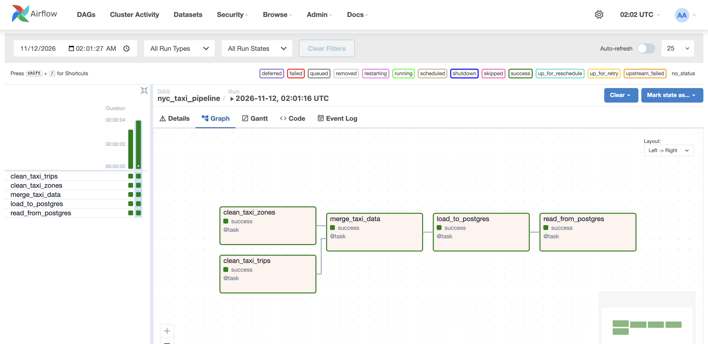
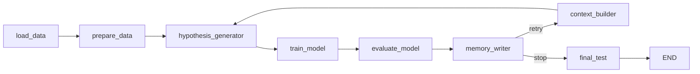
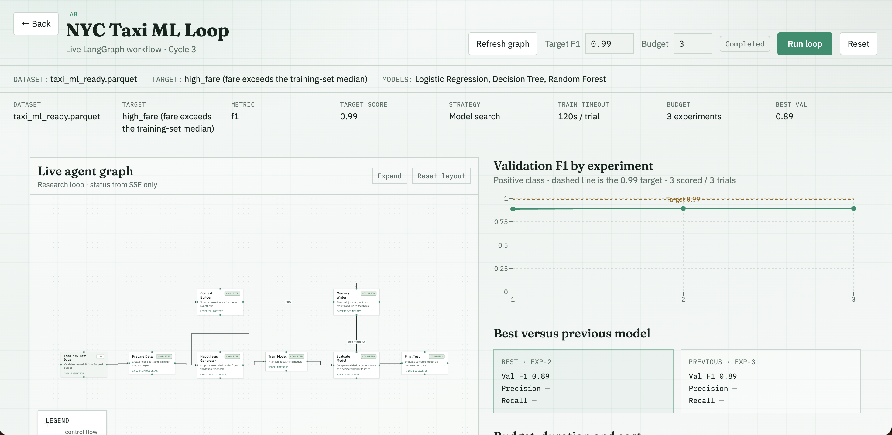
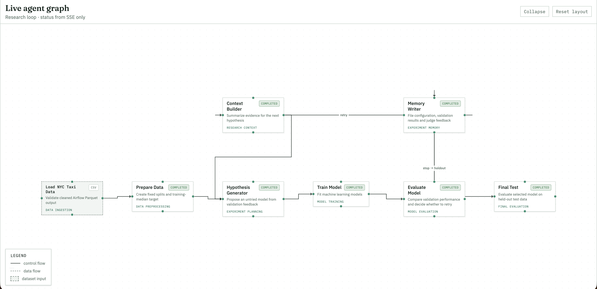
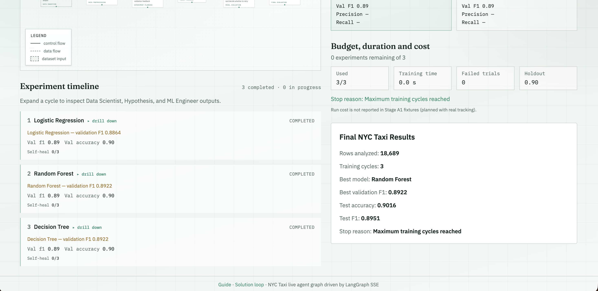
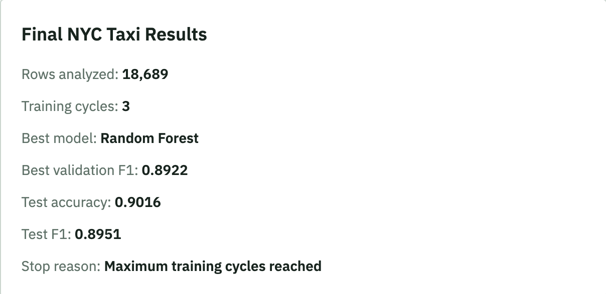

# NYC Taxi Data Pipeline and ML Workflow

## Project Overview

This project uses Apache Airflow and LangGraph to build an automated data processing and machine learning workflow using New York City yellow taxi trip data.

The objective is to predict whether a taxi fare is above the median fare using trip characteristics such as distance, passenger count, pickup time, and pickup borough.

The project consists of two parts:

1. An Airflow DAG that cleans, merges, and stores taxi data in PostgreSQL.
2. A custom LangGraph workflow that trains and evaluates classification models using conditional looping logic.

## Part 1: Apache Airflow Pipeline

### Datasets

Two datasets from the NYC Taxi & Limousine Commission (TLC) are used:

- January 2025 Yellow Taxi Trip Records
- NYC Taxi Zone Lookup Table

The original trip dataset contains approximately 3.48 million records. A reproducible sample of 20,000 trips was selected using `random_state=42`.

### DAG Structure

The custom DAG is located at:

`lab/airflow/dags/nyc_taxi_pipeline.py`

It contains five tasks:

1. **clean_taxi_trips:** Removes trips with nonpositive distances or fares, handles missing passenger counts, and creates pickup hour and weekday features.
2. **clean_taxi_zones:** Validates location IDs and cleans borough and zone information.
3. **merge_taxi_data:** Joins taxi trips with zone information using pickup location IDs.
4. **load_to_postgres:** Loads the merged dataset into the PostgreSQL `taxi_trips_cleaned` table.
5. **read_from_postgres:** Reads the cleaned records from PostgreSQL, verifies the row count, and saves a machine-learning-ready Parquet file.

The two cleaning tasks run independently before the merge, demonstrating parallel task execution.

### Scheduling

The DAG uses the following Airflow settings:

- Schedule: `@daily`
- Start date: November 1, 2026
- Catchup: `False`
- Maximum active runs: 1

Each scheduled execution reprocesses the same January 2025 sample. It does not automatically download new daily taxi records.

### Data Pipeline Results

- Initial sample: 20,000 trips
- Cleaned dataset: 18,689 trips
- Records removed: 1,311
- Average fare after cleaning: $17.92

The cleaned data is stored in PostgreSQL and exported to:

`artifacts/nyc_taxi/taxi_ml_ready.parquet`

Analysis of this database read-back export confirms 18,689 records and a mean fare of $17.92. Cleaning removed 6.56% of the sampled trips.

### Successful Airflow DAG Execution

The Airflow Graph view below shows all five tasks successful, including the parallel cleaning branches, merge, PostgreSQL load, and database read-back. It documents both successful execution and the DAG graph.



## Part 2: Agent-Based LangGraph ML Workflow

The classroom research loop is adapted in `lab/langgraph/nyc_taxi_graph.py` with explicit deterministic agents. It runs without an LLM API, API key, or external memory service.

### Agents and executable graph



- **Data Scientist — load_data / prepare_data:** Validate the cleaned Airflow output and split it 60/20/20 with seed 42: 11,213 training, 3,738 validation, and 3,738 test records. The target is `high_fare`: fare above the training-set median ($12.80). Features are trip distance, passenger count, pickup hour, pickup weekday, and borough; fare and target are excluded from inputs.
- **Hypothesis Generator:** Establish a Logistic Regression baseline, then consume recorded results and judge feedback. A baseline validation F1 of at least 0.88 leads to Random Forest; a lower score leads to a shallow Decision Tree. Subsequent experiments test remaining untried candidates, avoiding repeats.
- **ML Engineer — train_model:** Train the proposed candidate with preprocessing fitted on training data only; produce its configuration, rationale, validation accuracy, and F1.
- **Judge — evaluate_model:** Compare validation results, select the best model using full-precision F1, and provide feedback. Stop when the target is achieved, the experiment budget is reached, or all candidates have been tried.
- **Memory Writer:** Record each experiment's configuration, validation metrics, and judge feedback once in LangGraph state, including the terminal experiment before final testing.
- **Context Builder:** Summarize recorded experiments, the best model, and the latest judge feedback for the next hypothesis.
- **Final Holdout Evaluation — final_test:** Refit the selected model on training plus validation data and evaluate once on the held-out test split. Holdout metrics never influence experimentation or selection.

The graph has eight nodes because the Data Scientist role uses two nodes. Every judge decision passes through Memory Writer before the conditional retry or completion path.

### Verified results — updated workflow, November 12, 2026

Executed the existing CLI in the running gateway container against the Part 1 export: **18,689 rows**, target F1 **0.99**, budget **3**.

| Experiment | Model | Validation accuracy | Validation F1 |
| --- | --- | --- | --- |
| 1 | Logistic Regression | 0.896469 | 0.886410 |
| 2 | Random Forest | 0.901284 | 0.892200 |
| 3 | Decision Tree | 0.902087 | 0.892163 |

**Selected: Random Forest.** Validation F1: **0.8922**; holdout accuracy: **0.9016** (90.16%); holdout F1: **0.8951**. The workflow stopped at the **three-experiment budget**; the 0.99 target was not achieved.

Nonlinear models improved over the linear baseline. Random Forest narrowly beat Decision Tree on validation F1; both round to 0.8922 at four decimals, so selection uses full precision. Results may vary across scikit-learn versions.

### Run both workflows

The repository provides Docker Compose and service/Airflow Dockerfiles in `infra/`. Follow the [root setup guide](../../README.md#prerequisites) for prerequisites and environment setup. From the repository root:

```bash
# Part 1 (if the cleaned export is not already available)
make airflow
# Open http://localhost:8088 and trigger nyc_taxi_pipeline.

# Part 2, using the existing container's installed dependencies
# Start the existing stack first if necessary: make up
docker compose -f infra/docker-compose.yml --env-file .env exec -w /packages gateway \
  python -m lab.langgraph.nyc_taxi_run
```

With pandas, pyarrow, scikit-learn, and langgraph installed in an active local Python environment, the original CLI also works:

```bash
python -m lab.langgraph.nyc_taxi_run
```

### Live web interface

Start the existing development setup with `make start-mac` (or `make start-windows`). If the stack is already running, use `make frontend`. Open `/lab-loop` on the Vite URL printed in the terminal (normally port 5173; this workspace also serves port 5174).

Click **Refresh graph**, set target F1 to **0.99** and budget to **3**, then **Run loop**. The dashboard displays the eight-node workflow, target `high_fare`, experiment timeline, validation scores, and final holdout results. Select a node to inspect its execution notes.

### Browser verification and screenshots

The updated interface was opened and visually inspected in the browser by the author, including the eight-node graph, experiment timeline, and final evaluation. The retained screenshots below show the updated interface and Random Forest results.

**Dashboard and validation F1 chart**



**Expanded eight-node agent graph**



**Experiment timeline and evaluation**



**Final model results**



### Submission evidence

| Requirement | Repository evidence |
| --- | --- |
| Successful Airflow execution and DAG graph view | Airflow screenshot above, showing all five tasks successful |
| Airflow DAG source | [nyc_taxi_pipeline.py](../../lab/airflow/dags/nyc_taxi_pipeline.py) |
| Modified agents and live graph | [nyc_taxi_graph.py](../../lab/langgraph/nyc_taxi_graph.py) and updated graph screenshot above |
| Model evaluation | Validation table and final results screenshots above |
| Run instructions and containerized setup | Commands above, root setup guide, and [Docker Compose](../../infra/docker-compose.yml) |

The CLI, focused workflow checks, live event stream, frontend/backend graph parity, and frontend build passed during implementation. No additional workflow execution was performed for this documentation review.
